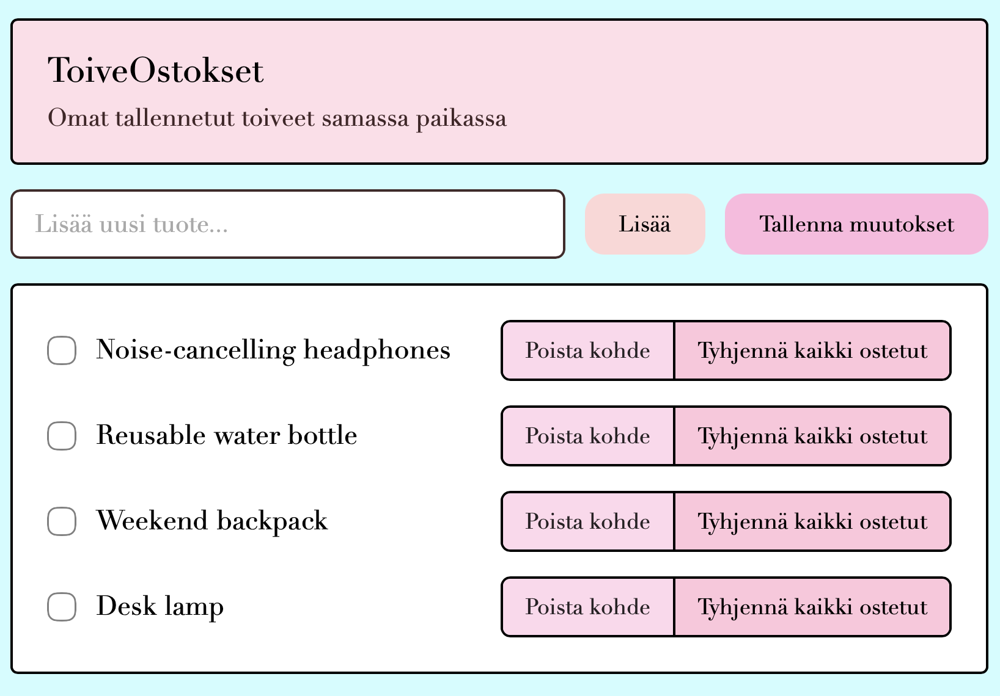

# ToiveOstokset - Toivelistasovellus

**Tekijä(t):** Nita Lallimo

## Projektisuunnitelma

### Projektin idea

ToiveOstokset on verkkosovellus, jossa käyttäjä voi luoda ostoslistan perustuen omaan toivelistaan. Listalle voi lisätä tuotteita myöhempää varten, niitä voi tarkastella sekä hallita. 

Kun käyttäjä on ostanut jonkin tuotteen toivelistalta, hän voi merkitä sen ostetuksi. Sovelluksen tarkoitus on helpottaa tarvittavien ostosten listaamista samaan paikkaan.

### Suunnitellut toiminnot

Listaa vähintään kolme sovellukseesi suunniteltua toimintoa:

- Tuotteen lisääminen
- Tuotteen merkitseminen ostetuksi
- Tietojen tallentaminen
- Toivelistan tarkastelu / hallinta (poistaminen)

### Rautalankamalli / luonnos

Lisää tähän kuva käsin piirtämästäsi tai digitaalisesti tehdystä sovelluksen luonnoksesta. Luonnoksessa tulee näkyä sovelluksen pääasiallinen näkymä ja tärkeimmät elementit.

Esimerkki kuvan lisäämisestä:

![Rautalankamalli] (img/rautalanka.png)

## Verkkolinkit

- **Julkaistu sovellus:** [Lisää tähän GitHub Pages -osoite](https://nipsu12.github.io/Project_1_DOM_skripting/)
- **GitHub-repositorio:** https://github.com/nipsu12/Project_1_DOM_skripting
- **Projektin videoesittely:** [Lisää tähän videon osoite](https://example.com/)

## Tietoja sovelluksesta

**[ToiveOstokset]** on verkkosovellus, jossa käyttäjä voi hallita tuotteita, joita haluaa ostaa myöhemmin.

Käyttäjä voi lisätä uusia tuotteita, merkitä tuotteita ostetuksi ja poistaa tuotteita. Sovellus toimii selaimessa.

## Teknologiat

- HTML: Rakenteen luominen - otsikot, teksikentät, painikkeet ja toivelistan luettelo
- CSS: Ulkoasun suunnittelu - värit, fontit, asettelu ja muotoilu
- JavaScript: Tuotteiden lisäys, poisto ja ostetuksi merkitseminen
- DOM-skriptaus: HTML-elementtien haku, luonti ja muokkaus

## Sovelluksen käyttö

Lyhyet käyttöohjeet sovellukselle.

1. Avaa julkaistu sovellus yllä olevasta linkistä.
2. Syötä tuotteen nimi tekstikenttään.
3. Paina "Lisää" sekä "Tallenna muutokset" painikkeita.
4. Poista tai merkitse tuotteita ostetuksi.

## Sovelluksen käynnistäminen paikallisesti

1. Kloonaa tai lataa tämä Github-repositorio omalle koneellesi.
2. Avaa projektikansio.
3. Avaa `index.html` selaimessa.
4. Kokeile sovelluksen toiminnallisuutta.

## Kuvakaappaukset

Lisää tähän vähintään yksi kuvakaappaus toimivasta sovelluksestasi.

Esimerkki kuvan lisäämisestä:

## Tunnetut virheet / puutteet

**Ei tunnettuja virheitä.**

## Oma arvio ja oppimisen reflektointi

Pohdi työtäsi ja oppimisprosessiasi.

- Onnistuin projektin rakenteen loogisessa luomisessa. Aloitin html-tiedoston luomisella, seuraavaksi tein script.js-tiedoston ja viimeisenä sommittelin sivustoa enemmän styles.css tiedostossa.
- Haastavinta oli saada sivu responsiviisuden lisäksi keskittymään keskelle näyttöä suurella näytöllä (esim. tietokone).
- Jos aikaa olisi enemmän, parantaisin verkkosovellusta esimerkiksi lisäämällä kirjautumisvaihtoehdon tai useampia TODO-listoja erilaisten kategorioiden mukaisesti.
- Tässä projektissa opin HTML:stä sen, ettei siellä tarvitse olla kaikki toiminnallisuudet vaan niitä voi suorittaa script.js:stä. DOM-skriptaus on minulle täysin uusi väline joten olen oppinut paljon elementtien sekä tyylien muokkaamisesta sen avulla.
- Haluaisin ymmärtää JavaScriptiä vielä paremmin, jotta voisin käyttää sitä yhtä sujuvasti kuin esimerkiksi Python ohjelmointikieltä. Myös localStoragen käyttö jäi projektin osalta kesken.
- Oma arvio projektista: **9/10 pistettä**

## Lähteet ja kiitokset

Suurimpana lähteenä projektissa on toiminut aiemmin kurssilla esitellyt koodit, joita on myös hyödynnetty työpajatehtävien tekemisessä. 

- [Programming knowledge: How to use localStorage in JavaScript] (https://www.youtube.com/watch?v=j-BsQhDsx24)
- Käytetty tekoälytyökalu: Gemini
  - Miten työkalua käytettiin: Gemini tekoälyä on käytetty projektin virheiden ratkaisemisessa sekä html ja script.js tietojen vastaavuuden tarkastamisessa.
- Käytetty tekoälytyökalu: Lucid AI
  - Miten työkalua käytettiin: Rautalankamallin luomisessa käytetty Lucid Chartin omaa Lucid AI:ta apuna.
  
  ## Lisenssi

Tämä projekti on lisensoitu MIT-lisenssillä.